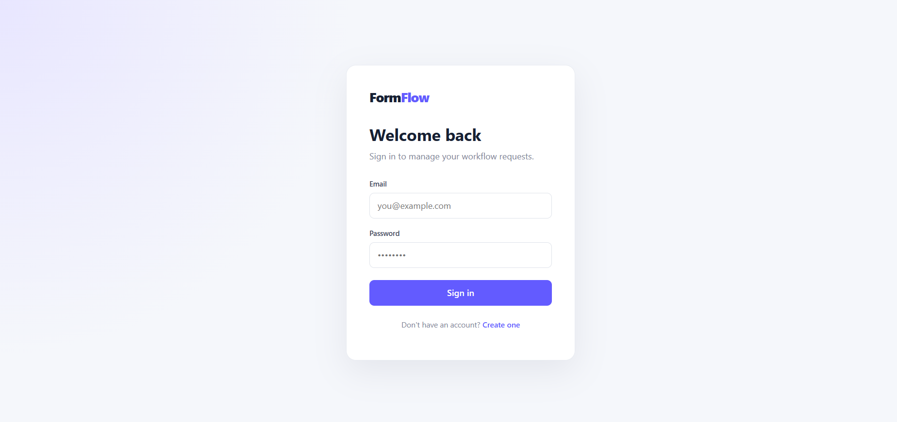
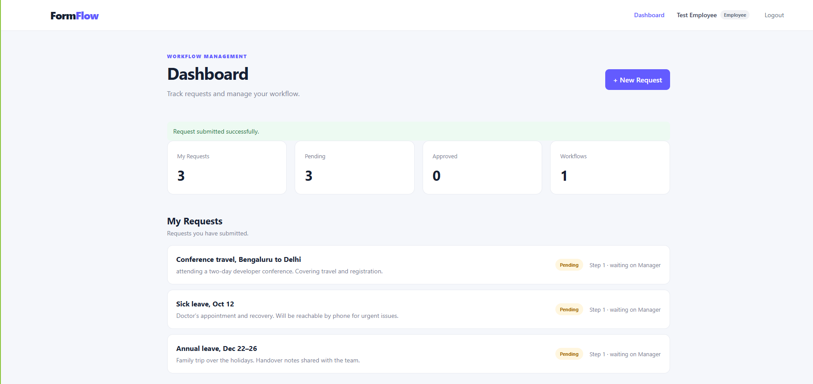
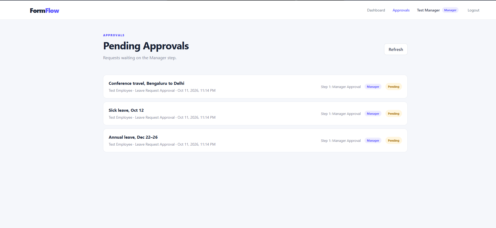
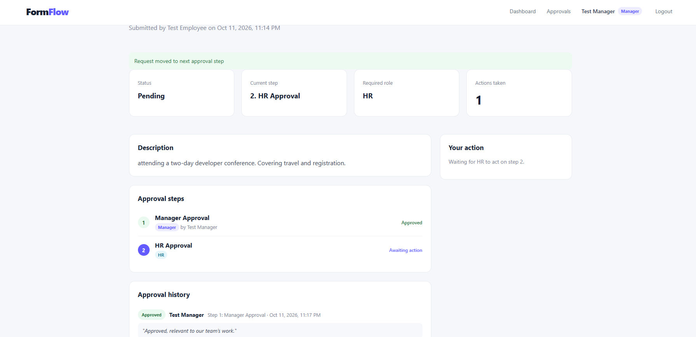
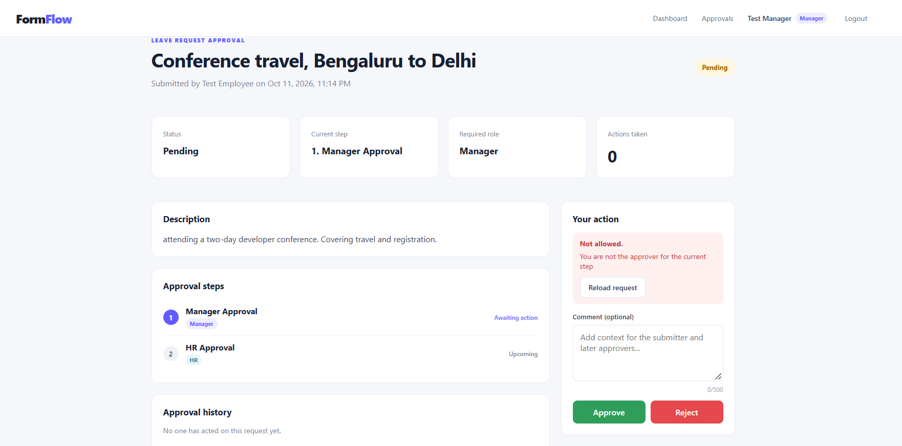
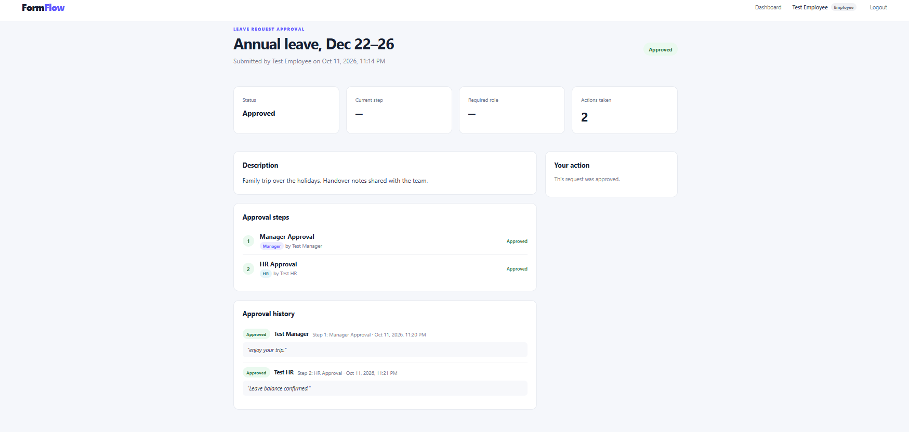
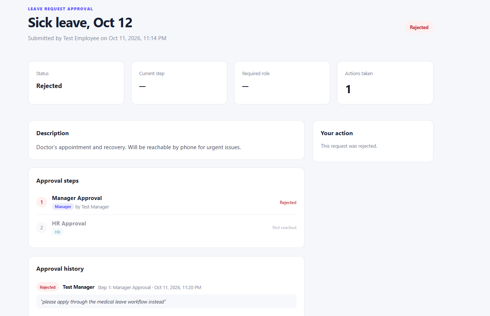
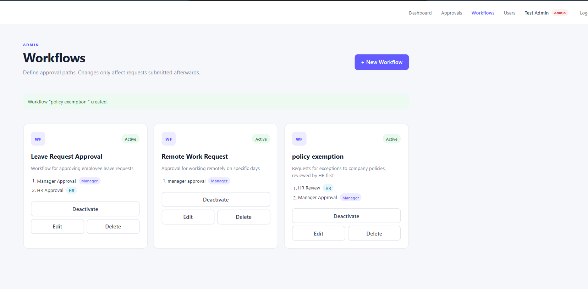
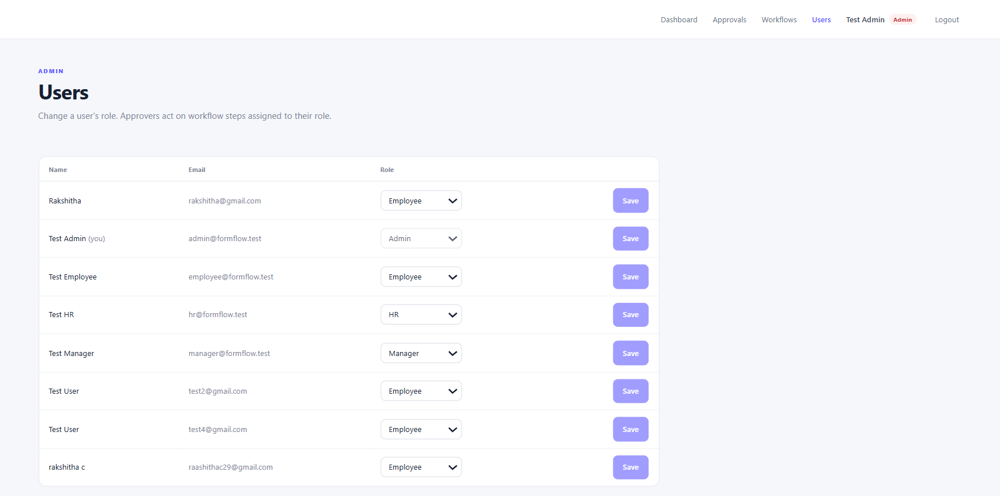
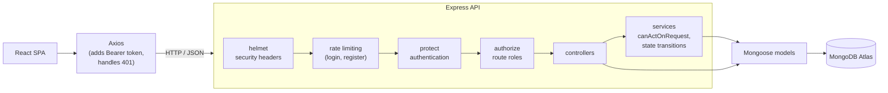

# FormFlow

[](https://github.com/Rakshitha-c29/formflow/actions/workflows/test.yml)

A multi-stage workflow and approval engine with role-based, stage-aware authorization.

**Live demo:** https://formflow-sigma-one.vercel.app/
 (sign in with the [demo accounts](#seed-demo-data), password `Demo@2026`)

> The backend runs on a free hosting tier that sleeps when idle, so the first request after a quiet period can take up to a minute while it wakes up. Later requests are fast.

## Overview

FormFlow lets employees submit requests against configurable approval workflows. Each workflow is an ordered list of stages, and each stage is assigned to a role (manager, HR, admin). The backend decides who may act at each stage, advances the request through the workflow, records an approval history, and finishes the request as approved or rejected.

The project focuses on backend correctness: layered authorization, an explicit state machine, protection against concurrent approvals, and a test suite of 273 tests that runs against an in-memory MongoDB.

## Features

### Employees (any signed-in user)
- Register and sign in; sessions use JWTs and end cleanly on expiry or revocation.
- Submit a request against any active workflow.
- Track each request's status, current stage, and the role it is waiting on.
- View a request's full approval history, including approvers' comments.
- Dashboard totals (submitted, pending, approved) computed on the server.

### Approvers (manager, HR)
- A pending-approvals queue containing only requests whose current stage is assigned to their role, never their own.
- Approve or reject with an optional comment.
- Clear feedback when an action is refused (403) or loses a race with another approver (409).
- Read access to requests they have acted on or are currently responsible for.

### Admins
- Create, edit, activate/deactivate, and delete workflows. Deleting a workflow that requests still use is refused.
- Change users' roles; the change applies on the user's next request, with no re-login.
- View all pending requests. Admins configure the system but can approve only stages assigned to the admin role.

## Screenshots

**Login.** JWT-based authentication with role-aware navigation.



**Employee dashboard.** Employees submit requests against active workflows and track each request's status and current stage.



**Pending approvals.** Approvers see only requests waiting on their role at the current stage, never their own.



**Multi-stage progression.** When the manager approves, the request advances to the next stage defined in the workflow, and the step records who approved it.



**Stage-based authorization.** An approver acting on an outdated page is refused, because the backend re-checks permissions against the request's current stage on every action.



**Completed request.** After the final stage approves, the request reaches its terminal Approved state with a full approval history.



**Rejection ends the workflow.** A rejection is terminal; later stages are never reached.



**Workflow configuration.** Admins define approval paths as data. Requests snapshot their workflow at submission, so edits never affect requests already in progress.



**Role management.** Admins assign roles; changes take effect on the user's next request without logging in again.



## Tech Stack

| Layer | Technology |
|---|---|
| Frontend | React 19, Vite, React Router, Axios, plain CSS |
| Backend | Node.js, Express 5, Mongoose |
| Database | MongoDB Atlas |
| Auth | bcrypt, JSON Web Tokens |
| Security | helmet, express-rate-limit |
| Testing | Jest, Supertest, mongodb-memory-server |
| Deployment | Vercel (frontend), Render (API), GitHub Actions (CI) |
## Architecture



Errors from every layer flow into one error handler that produces a consistent response format. Controllers stay thin; approval rules live in `server/services/request.service.js`.

## Data Model

**User**: `name`, `email` (unique, lowercase), `password` (bcrypt hash, excluded from queries by default), `role` (`employee`, `manager`, `hr`, `admin`).

**Workflow**: `name`, `description`, `createdBy`, `isActive`, and `steps`, each with a `stepNumber` (positive whole number, unique within the workflow), a `name`, and an `approverRole`.

**Request**
- `workflow`, `submittedBy`, `title` (max 150), `description` (max 2000)
- `steps`: a snapshot of the workflow's steps taken at submission
- `status`: `pending`, `approved`, or `rejected`
- `currentStep`: the `stepNumber` of the stage awaiting action
- `approvalHistory`: entries of `stepNumber`, `action`, `actedBy`, `comment` (max 500), `actedAt`
- Indexes: `{ submittedBy, createdAt }` for "my requests", `{ status, workflow }` for pending queues

## Authorization

Every protected request passes three independent layers:

| Layer | Question | Failure |
|---|---|---|
| `protect` | Is this a valid token for a user who still exists? Loads the user and role from the database. | 401 |
| `authorize(...roles)` | Is this role allowed to use this route at all (e.g. admin-only workflow management)? | 403 |
| `canActOnRequest` / `canViewRequest` | May this user act on, or view, this specific request in its current state? | 403 |

The third layer depends on the request itself:
- **Acting**: the request must be pending, the user's role must match the current stage's `approverRole`, and the user must not be the submitter (no self-approval).
- **Viewing**: allowed for the submitter, admins, anyone who has already acted on the request, and the current stage's approver. A role assigned only to a later stage cannot see the request until it arrives.

**Separation of duties.** Admins configure workflows and roles and can view every request, but they cannot approve a stage assigned to another role. An admin acts only on stages whose `approverRole` is `admin`. Admins also cannot change their own role.

## Approval State Machine and Concurrency

```text
pending @ step N ──approve──▶ pending @ next step      (if a later step exists)
pending @ step N ──approve──▶ approved                 (final step)
pending @ step N ──reject───▶ rejected                 (terminal)
approved / rejected ──any action──▶ 400
```

- `currentStep` holds a `stepNumber`, not an array position. The next stage is the step with the next-highest `stepNumber`, so numbering such as 10, 20, 30 works.
- Stages cannot be skipped: only the current stage's role can act, and each approval advances exactly one stage.
- **Concurrent approvals** are handled with a conditional atomic update. The approval is written with `findOneAndUpdate` filtered on `{ _id, status: "pending", currentStep: <the step that was read> }`. If another approver acted first, nothing matches and the API returns **409 Conflict** instead of recording a second approval. Because the permission check depends only on `status` and `currentStep`, a matching filter guarantees the check is still valid at write time.

## Security

- **Passwords** are hashed with bcrypt and excluded from every query unless explicitly selected for login.
- **Password policy** for registration: at least 8 characters, including at least one letter and one number. Violations return 400 with a clear message.
- **JWTs** are signed and verified with HS256 only (the algorithm is pinned, so tokens with other algorithms or `alg: none` are rejected) and expire after 1 day by default.
- **Roles are loaded from the database** on every request, so role changes and deleted accounts take effect immediately.
- **Rate limiting** on authentication: 10 attempts per 15 minutes per IP. Login counts only failed attempts, so legitimate users are not locked out. Registration counts every attempt. Excess attempts receive 429.
- **Trust proxy**: when `TRUST_PROXY=true`, the client IP is taken from `X-Forwarded-For` so rate limits apply per user behind a reverse proxy. It is off by default, because without a proxy that header can be spoofed.
- **helmet** sets security headers (`nosniff`, frame protection, HSTS, CSP, referrer policy) and removes `X-Powered-By`.
- **Input validation** rejects non-string credentials (blocking NoSQL operator injection such as `{"$ne": null}`), malformed IDs, malformed JSON, and invalid pagination parameters.
- **Consistent errors**: every error response has the form `{ "success": false, "message": "...", "errors": [...] }`, where `errors` lists field-level problems for validation failures. Unexpected errors return a generic 500 message; details are logged only on the server.
- **CORS** allows only the configured client origin.

## Design Decisions and Tradeoffs

**Roles from the database, not the token.** The JWT carries the user ID, but `protect` loads the current user on each request. This costs one indexed lookup per request and means a demoted or deleted user loses access immediately, instead of when their token expires.

**Workflow step snapshots.** A request copies its workflow's steps when it is submitted. Editing, deactivating, or deleting a workflow therefore never changes the approval path of a request already in progress. The cost is some duplicated data per request.

**Workflow editing and guarded deletion.** Edits go through the same schema validation as creation and apply only to future requests. Deletion is refused with 409 while any request (including completed ones, whose history still references it) uses the workflow; the message suggests deactivating instead, which stops new submissions while keeping history intact.

**Accepted race in deletion.** Deletion checks for referencing requests and then deletes, which leaves a small check-then-act (TOCTOU) window in which a request could be submitted. The consequence is limited: that request keeps working because it carries its own step snapshot, and only its link to the workflow is orphaned. Closing the window would require a multi-document transaction, which was judged unnecessary at this scale.

**Pending queue filtered in the database.** "Waiting on my role" means the step matching `currentStep` has the user's `approverRole`. This is computed in the query with `$expr`, so pagination totals are exact, and a test verifies it agrees with `canActOnRequest` across mixed data. The alternative, a denormalized `currentApproverRole` field, would allow a simple indexed query but must be kept in sync on every transition and migrated. It is the natural next step if the pending query becomes a bottleneck.

**Offset pagination.** Lists use `page` and `limit` with `skip`, sorted with `_id` as a tie-breaker so pages never overlap. Offset pagination is simple and supports "page X of Y", but deep pages get slower and items can shift between pages when data changes. Cursor-based pagination would avoid both if lists grow large.

**In-memory rate limit counts.** Counters are kept in each server process's memory. This is correct for a single instance, but counts reset on restart and are not shared across instances. Running multiple instances would require a shared store such as Redis.

## API Reference

All paths are prefixed with `/api`. Protected endpoints require `Authorization: Bearer <token>`.

### Auth

| Method | Path | Access | Description |
|---|---|---|---|
| POST | `/auth/register` | Public (rate limited) | Create an account with the `employee` role |
| POST | `/auth/login` | Public (rate limited, failures only) | Returns a JWT and the user |
| GET | `/auth/profile` | Authenticated | Current user, loaded from the database |

### Workflows

| Method | Path | Access | Description |
|---|---|---|---|
| GET | `/workflows` | Authenticated | Admins see all workflows; others see active ones |
| GET | `/workflows/:id` | Authenticated | One workflow (inactive ones visible to admins only) |
| POST | `/workflows` | Admin | Create a workflow |
| PUT | `/workflows/:id` | Admin | Replace name, description, and steps (future requests only) |
| PATCH | `/workflows/:id/status` | Admin | Activate or deactivate (`{ "isActive": true/false }`) |
| DELETE | `/workflows/:id` | Admin | Delete; 409 if any request uses it |

### Requests

| Method | Path | Access | Description |
|---|---|---|---|
| POST | `/requests` | Authenticated | Submit a request (`workflowId`, `title`, `description`) |
| GET | `/requests` | Authenticated | The user's own requests, newest first (paginated) |
| GET | `/requests/stats` | Authenticated | The user's totals: `total`, `pending`, `approved`, `rejected` |
| GET | `/requests/pending` | Authenticated | Requests waiting on the user's role at their current stage; all pending requests for admins (paginated) |
| GET | `/requests/:id` | Submitter, admin, past or current approver | One request with steps and history |
| PATCH | `/requests/:id/action` | Current stage's role, not the submitter | `{ "action": "approved" \| "rejected", "comment": "..." }`; 409 on a concurrent update |

### Users

| Method | Path | Access | Description |
|---|---|---|---|
| GET | `/users` | Admin | List users (paginated) |
| PATCH | `/users/:id/role` | Admin | Change a user's role (not your own) |

### Pagination

`GET /requests`, `GET /requests/pending`, and `GET /users` accept:

| Parameter | Default | Rules |
|---|---|---|
| `page` | 1 | Whole number, at least 1 |
| `limit` | 20 | Whole number, 1 to 100 |

Responses include the items plus `count` (items on this page), `total`, `page`, `limit`, and `totalPages`. Invalid parameters return 400; a page past the end returns an empty list.

## Setup

### Prerequisites
- Node.js 22 or later
- A MongoDB Atlas cluster (or any MongoDB instance) for running the app. Tests do not need one.

### Environment variables

Create `server/.env`:

```env
MONGO_URI=mongodb+srv://<user>:<password>@<cluster-host>/<database>
JWT_SECRET=<a-long-random-secret>

# Optional (defaults shown)
PORT=5000
JWT_EXPIRES_IN=1d
CLIENT_URL=http://localhost:5173
# TRUST_PROXY=true   # only when running behind a reverse proxy
```

The server exits at startup if `MONGO_URI` or `JWT_SECRET` is missing.

The frontend reads the API location from `VITE_API_URL` and defaults to `http://localhost:5000/api`, so no client configuration is needed locally. For other environments, copy `client/.env.example` to `client/.env` and set:

```env
VITE_API_URL=https://<your-api-host>/api
```

Vite embeds this value at build time, so rebuild the client after changing it.

### Install

```bash
cd server && npm install
cd ../client && npm install
```

### Seed demo data

```bash
cd server
npm run seed
```

The seed script is safe to re-run. It creates or updates one demo account per role, all with the password `Demo@2026`:

| Email | Role |
|---|---|
| `employee@formflow.test` | Employee |
| `manager@formflow.test` | Manager |
| `hr@formflow.test` | HR |
| `admin@formflow.test` | Admin |

It also creates three demo workflows if they do not exist:

| Workflow | Stages |
|---|---|
| Leave Request Approval | Manager → HR |
| Remote Work Request | Manager |
| Policy Exception | HR → Manager |

Existing workflows with these names are left unchanged, so an admin's edits survive a re-run. The script also migrates legacy `user` roles to `employee` and backfills step snapshots on older requests.

To reset a public demo environment back to a clean state:

```bash
npm run seed:reset
```

This is destructive. It **deletes all requests, every user other than the four demo accounts, and every workflow other than the three demo workflows** (a renamed demo workflow counts as non-demo and is replaced by the original). It then restores the demo accounts' names, roles, and passwords and the demo workflows' stages and active state.

As a safeguard, `seed:reset` refuses to run unless the database name ends in `_demo`, and exits with an error before changing anything. Point `MONGO_URI` at a dedicated demo database to use it, for example:

```env
MONGO_URI=mongodb+srv://<user>:<password>@<cluster-host>/formflow_demo
```

A `MONGO_URI` without a database name connects to MongoDB's default `test` database, so `seed:reset` will refuse it. The normal `npm run seed` has no such restriction because it never deletes data.

### Run

```bash
# Terminal 1: API on http://localhost:5000
cd server
npm run dev

# Terminal 2: frontend on http://localhost:5173
cd client
npm run dev
```
## Deployment

- **Frontend**: Vercel, built from `client/` with `VITE_API_URL` pointing at the API.
- **API**: Render, from `server/`, with `TRUST_PROXY=true` behind Render's proxy and `CLIENT_URL` set to the frontend's origin.
- **Database**: a dedicated `formflow_demo` database on MongoDB Atlas, accessed by a database user with read/write rights on that database only.
- **CI**: GitHub Actions runs the server test suite and the client lint and build on every push and pull request.

## Testing

```bash
cd server
npm test
```

The suite runs against an in-memory MongoDB started by Jest, so it needs no database, no `.env`, and no network access after the first run, which downloads a MongoDB binary (about 74 MB) and caches it. Each test file uses its own database, so files run in parallel.

**273 tests in 15 suites, completing in about 10 seconds** on a development machine.

Coverage includes:
- **Authentication**: registration validation and password policy, duplicate email (409), login, password never returned, HS256 pinning (other algorithms and `alg: none` rejected), expired tokens, 1-day default expiry.
- **Authorization**: every admin-only route rejects each other role; role changes apply to existing tokens immediately; request view and action rules; self-approval blocked.
- **State machine**: no action on completed requests, no skipping stages, wrong role refused, invalid actions rejected, missing workflow or request rejected, non-consecutive step numbers.
- **Concurrency**: a forced race between read and write returns 409; simultaneous approvals let exactly one through.
- **Snapshots and workflow management**: edits and deletion do not affect in-flight requests; deletion is allowed when unused and refused with 409 when used; edit validation matches create.
- **Pagination**: parameter validation, page boundaries, no overlap between pages, the pending filter matching `canActOnRequest` across all pages, and stats independent of pagination.
- **Security middleware**: rate limiting (429 format, failures-only login, per-IP limits with and without trust proxy), helmet headers, CORS origin.
- **Seed script**: demo users and workflows created, idempotent re-runs that preserve admin edits, `--reset` removing all requests and non-demo users and workflows and restoring demo data, and the `_demo` database-name guard refusing a reset elsewhere without deleting anything.

Key rules were also checked by deliberately breaking them and confirming that tests fail.

## Future Improvements


- **Relationship-based approver routing**: route a stage to the submitter's own manager rather than to any user with the manager role.
- **Conditional routing**: choose stages based on request data (for example, an extra approval above an amount threshold).
- **Notifications**: alert approvers when a request reaches their stage, and submitters when it completes.
